# Manual de usuario · TraceLens (Project Dossier)

Versión del 2026-11-11, escrita sobre la rama `docmac`. Tarea S7.7.

> Las pantallas son de un entorno de prueba con datos **ficticios** (Jane Doe, Acme Europe SA).
> Este manual se adelantó al congelamiento de funcionalidades (S7.0). Si algo cambia antes de la
> entrega, hay que revisar la sección correspondiente.

## Contenido

1. [Qué es TraceLens](#1-qué-es-tracelens)
2. [Entrar a la plataforma](#2-entrar-a-la-plataforma)
3. [La pantalla principal](#3-la-pantalla-principal)
4. [Calendario y automatización](#4-calendario-y-automatización)
5. [Generar un dossier](#5-generar-un-dossier)
6. [Mis Dossiers](#6-mis-dossiers)
7. [Leer un dossier](#7-leer-un-dossier)
8. [Compartir y enviar por correo](#8-compartir-y-enviar-por-correo)
9. [Notificaciones](#9-notificaciones)
10. [Configuración](#10-configuración)
11. [Roles y permisos](#11-roles-y-permisos)
12. [Administración de la plataforma](#12-administración-de-la-plataforma)
13. [Planes, créditos y límites](#13-planes-créditos-y-límites)
14. [Mensajes frecuentes y qué hacer](#14-mensajes-frecuentes-y-qué-hacer)

---

## 1. Qué es TraceLens

TraceLens prepara **dossiers**: informes breves sobre una persona o una empresa antes de una
reunión. Cruza fuentes públicas y de terceros y las resume con inteligencia artificial:

- registros mercantiles oficiales del Reino Unido (Companies House), EE. UU. (SEC EDGAR), Francia
  y Alemania;
- prensa (GDELT y NewsAPI);
- perfiles profesionales (People Data Labs).

Cada dato del dossier indica **de qué fuente salió y cuándo se consultó**. Los dossiers se
**borran solos a las 24 horas** (ver [10.1](#101-general)).

## 2. Entrar a la plataforma

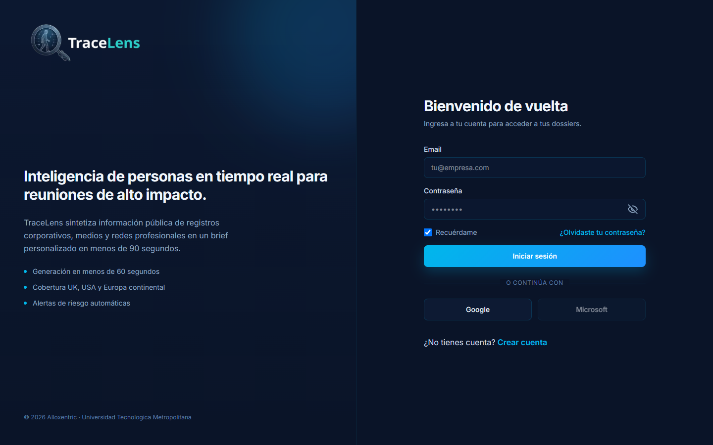

- **Iniciar sesión:** correo y contraseña, o el botón **Google**.
- **Crear cuenta:** enlace «Crear cuenta». Las cuentas de empresa requieren un correo
  corporativo (no Gmail ni Outlook personal).
- **¿Olvidaste tu contraseña?:** te enviamos instrucciones al correo.
- Tras varios intentos fallidos seguidos, la plataforma pide esperar unos segundos antes de
  volver a intentar.

## 3. La pantalla principal

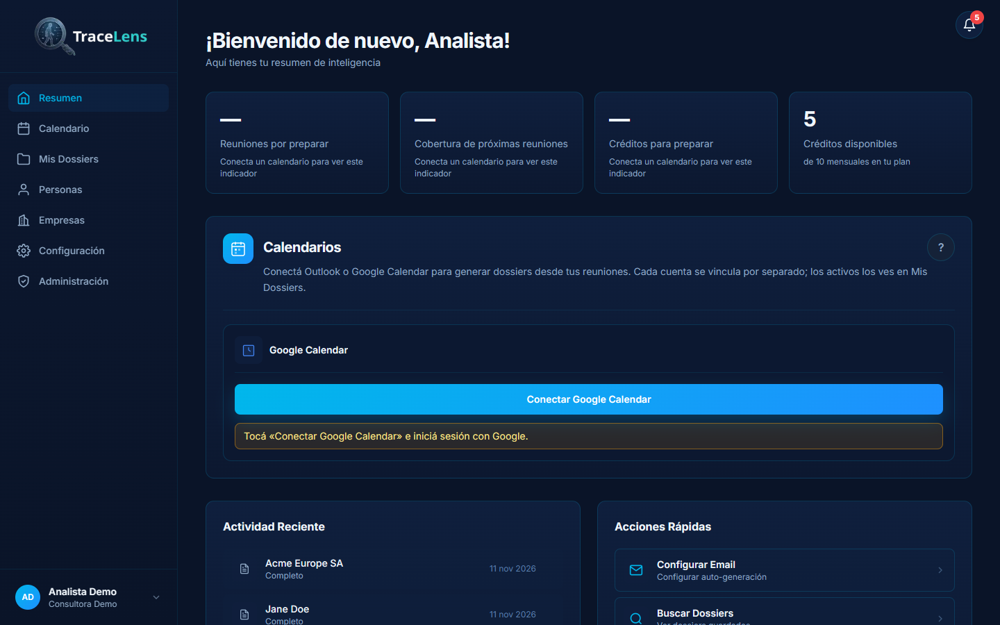

La **barra lateral** lleva a cada sección:

| Opción | Para qué sirve |
|---|---|
| **Resumen** | Indicadores, calendarios conectados, actividad reciente y accesos rápidos |
| **Calendario** | Tus reuniones y la generación de dossiers desde ellas ([4](#4-calendario-y-automatización)) |
| **Mis Dossiers** | Todos los dossiers que puedes ver ([6](#6-mis-dossiers)) |
| **Personas** | Dossier de una persona ([5.1](#51-dossier-de-una-persona)) |
| **Empresas** | Dossier de una empresa ([5.2](#52-dossier-de-una-empresa)); no está en el plan Free |
| **Configuración** | Tus preferencias, tu equipo y tu plan ([10](#10-configuración)) |
| **Administración** | Solo para el equipo que opera la plataforma ([12](#12-administración-de-la-plataforma)) |

Los indicadores del Resumen («Reuniones por preparar», «Cobertura de próximas reuniones»,
«Créditos para preparar») se llenan al conectar un calendario. «Créditos disponibles» muestra el
saldo de tu organización.

La **campana** de arriba a la derecha avisa de cada dossier nuevo ([9](#9-notificaciones)).

## 4. Calendario y automatización

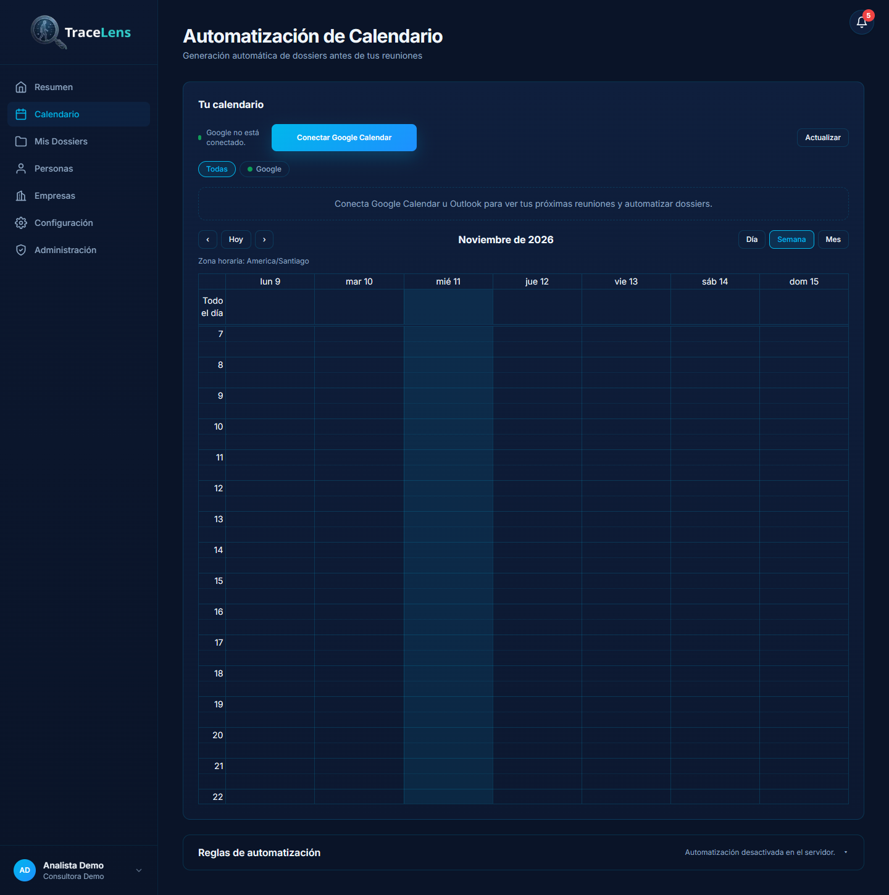

1. Pulsa **Conectar Google Calendar** (u Outlook) e inicia sesión con esa cuenta. Cada cuenta se
   conecta por separado.
2. Tus reuniones aparecen en vista **Día**, **Semana** o **Mes**, en tu zona horaria (se ve sobre
   la grilla y se cambia en [Idioma y región](#104-idioma-y-región)).
3. Al abrir una reunión ves participantes, lugar y descripción. **Generar dossier** prepara el
   dossier de la empresa y de los asistentes de esa reunión.

**Consejo:** el dossier sale mejor si la descripción de la reunión dice la empresa y el contacto,
por ejemplo `Empresa: Acme` y `Contacto: Ana Pérez`. Si falta, la ficha lo avisa.

**Automatización** (planes Pro y Enterprise): en **Reglas de automatización** se activa la
generación sola antes de cada reunión. Esos dossiers llegan por correo y aparecen en la campana.
Si dice «Automatización desactivada en el servidor», la tiene que activar quien opera la plataforma.

## 5. Generar un dossier

### 5.1 Dossier de una persona

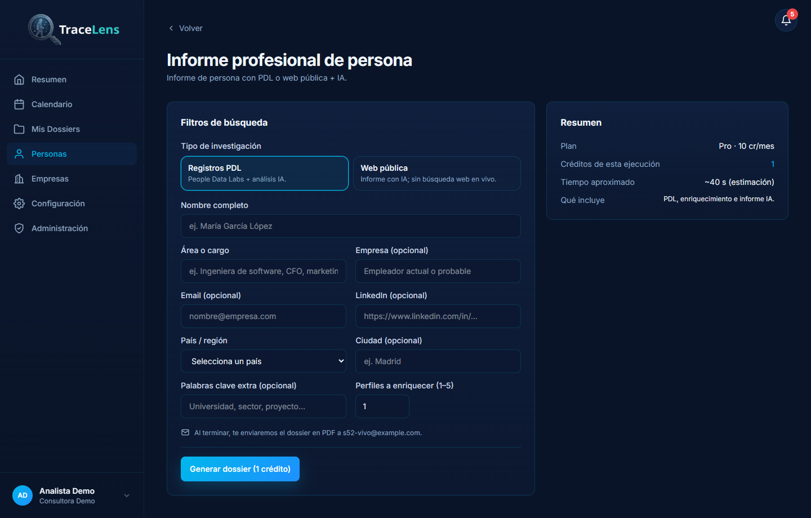

1. Elige el **tipo de investigación**:
   - **Registros PDL:** People Data Labs más análisis con IA.
   - **Web pública:** informe con IA, sin búsqueda web en vivo.
2. Escribe el **nombre completo**. Los demás campos son opcionales, pero ayudan a no confundir a
   la persona con otra del mismo nombre: cargo, empresa, correo, LinkedIn, país y ciudad.
3. **Perfiles a enriquecer (1–5):** cuántos perfiles candidatos se analizan.
4. Pulsa **Generar dossier**. El cuadro «Resumen» muestra el costo en créditos y el tiempo
   aproximado.

### 5.2 Dossier de una empresa

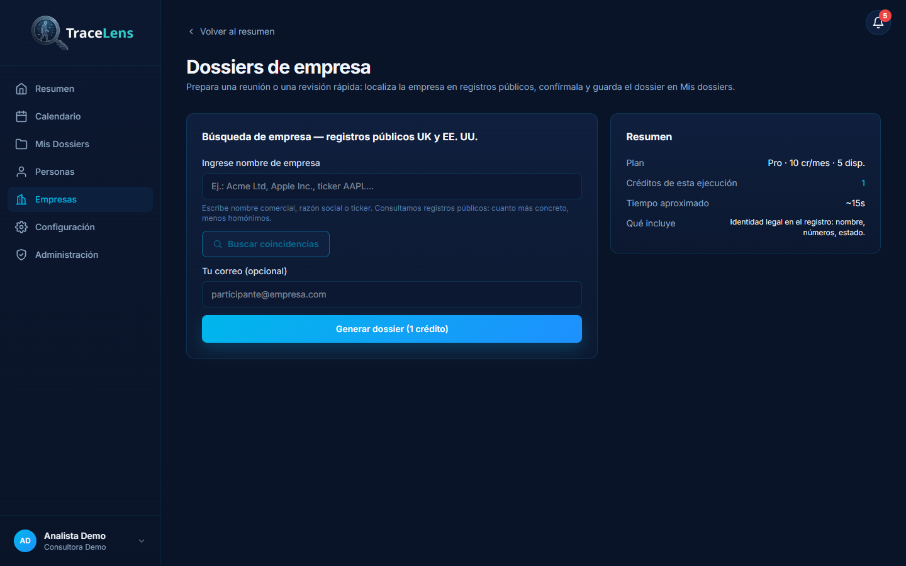

1. Escribe el nombre comercial, la razón social o el ticker (ej. `AAPL`).
2. **Buscar coincidencias** consulta los registros públicos y muestra las empresas encontradas.
   Elige la correcta: cuanto más concreto el nombre, menos homónimos.
3. Pulsa **Generar dossier**.

### 5.3 Mientras se genera

- Puedes seguir usando la plataforma: un **aviso flotante** muestra el avance por etapa y por
  fuente consultada, con **resultados parciales** a medida que llegan.
- **Cancelar** detiene la generación.
- Si se corta la conexión, la página **se reconecta sola**, esperando cada vez un poco más (de 1 a
  30 segundos). También puedes pulsar **Reconectar**. Un corte de conexión no cancela el dossier.
- Al terminar te avisamos en la campana y, si el envío por correo está activo, te llega el dossier
  en PDF (la pantalla lo indica bajo el formulario).

## 6. Mis Dossiers

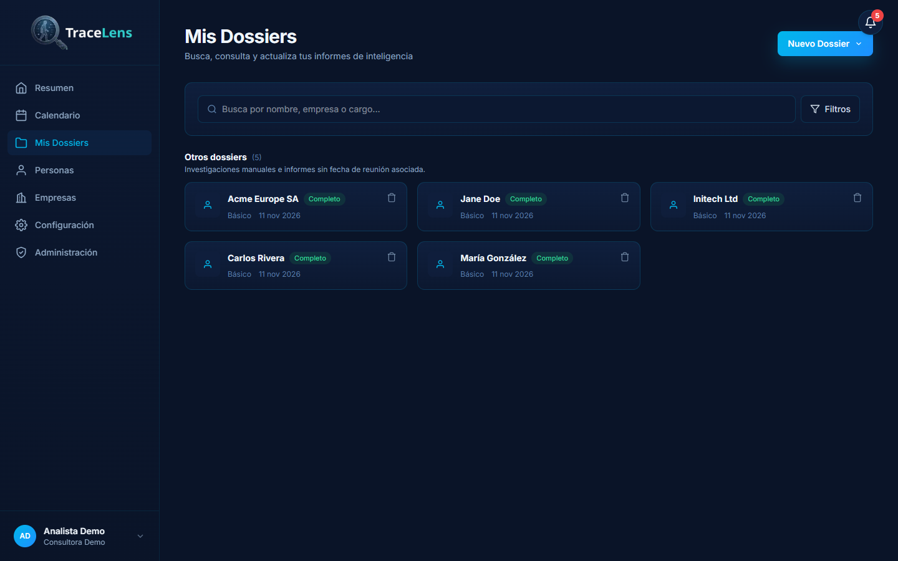

- **Buscar** por nombre, empresa o cargo, y **Filtros** por estado o tipo.
- Los dossiers de una misma reunión se agrupan en una **carpeta** con la fecha de la reunión.
  Los demás aparecen en «Otros dossiers».
- **Nuevo Dossier** lleva a Personas o Empresas.
- El ícono de papelera **elimina** el dossier (no se puede deshacer).

## 7. Leer un dossier

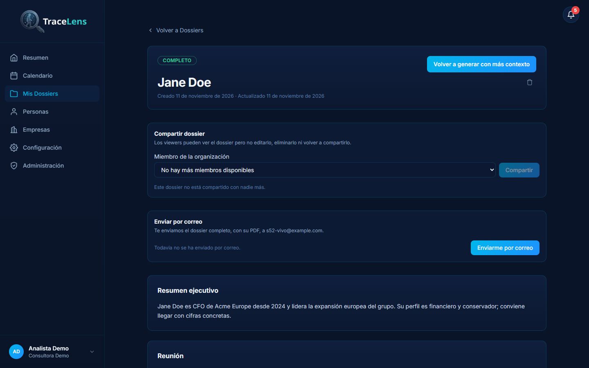

El encabezado muestra el estado, el nombre y las fechas. Desde ahí puedes:

- **Volver a generar con más contexto:** si el dossier encontró a la persona o empresa equivocada,
  repítelo con más datos, como la razón social, el ticker o el país.
- **Compartir** y **Enviar por correo** ([8](#8-compartir-y-enviar-por-correo)).

### 7.1 Secciones

Los dossiers nuevos se muestran **por secciones**. Una sección sin datos no aparece.

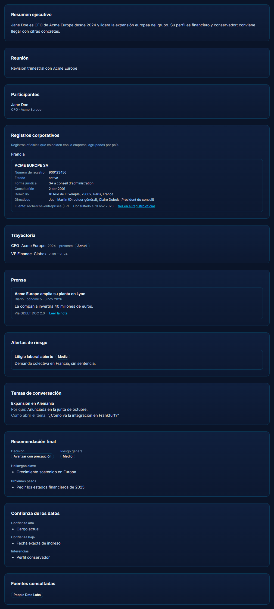

| Sección | Qué contiene |
|---|---|
| Resumen ejecutivo | Lo esencial en pocas líneas |
| Reunión y Participantes | La reunión y quiénes asisten, con cargo y empresa |
| Registros corporativos | Datos oficiales de la empresa ([7.2](#72-registros-corporativos-y-prensa)) |
| Trayectoria | Cargos actuales y anteriores |
| Prensa | Noticias recientes ([7.2](#72-registros-corporativos-y-prensa)) |
| Alertas de riesgo | Litigios, sanciones u otros puntos de atención, con su gravedad |
| Temas de conversación | Por qué sacar cada tema y cómo abrirlo |
| Recomendación final | Decisión sugerida (avanzar, con precaución, revisión legal o no avanzar), riesgo general, hallazgos y próximos pasos |
| Confianza de los datos | Qué está confirmado, qué no y qué es una inferencia |
| Fuentes consultadas | Las fuentes usadas, con enlace cuando lo hay |

El informe completo en texto sigue disponible: pulsa **Ver informe en texto** al final.

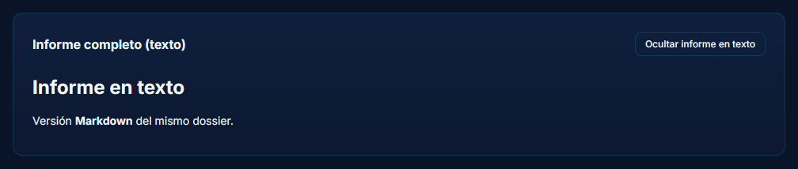

Los dossiers más antiguos, generados antes de las secciones, se ven solo como informe en texto.

### 7.2 Registros corporativos y prensa

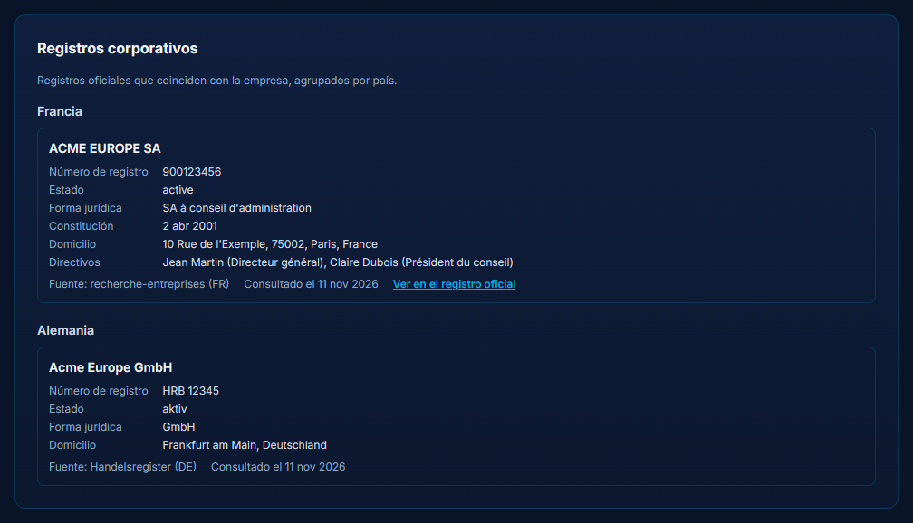

Los registros oficiales se agrupan **por país**. Cada uno trae número de registro, estado, forma
jurídica, fecha de constitución, domicilio y directivos. **Ver en el registro oficial** abre la
ficha en el sitio del registro.

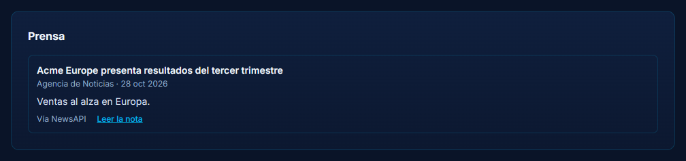

Cada noticia trae titular, medio, fecha, resumen, la fuente que la encontró («Vía NewsAPI» o
«Vía GDELT») y **Leer la nota**. Los enlaces se abren en una pestaña nueva.

> Las menciones de prensa pueden referirse a otra persona o empresa con el mismo nombre. La
> plataforma descarta los homónimos evidentes, pero conviene revisarlas.

## 8. Compartir y enviar por correo

- **Compartir dossier:** elige a un miembro de tu organización y pulsa **Compartir**. Quien lo
  recibe lo ve en Mis Dossiers. Un *viewer* puede verlo, pero no editarlo, eliminarlo ni volver a
  compartirlo.
- **Enviar por correo:** te envía el dossier completo, con su PDF, a tu correo. Después de enviarlo
  hay que esperar un momento antes de volver a enviarlo.

### El enlace del correo

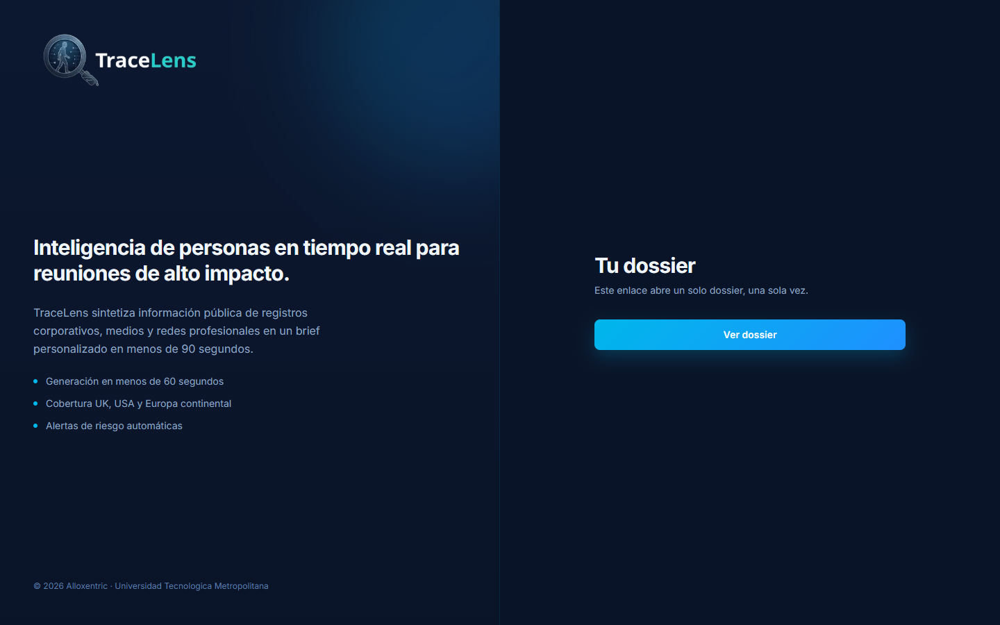

El botón del correo abre **solo ese dossier, sin iniciar sesión**, para leerlo desde el celular u
otro equipo:

- sirve **una sola vez**: se gasta al pulsar **Ver dossier**, no al abrir la página;
- **vence en 24 horas**;
- si ya se usó o venció, entra a la plataforma con tu cuenta para verlo.

No reenvíes ese correo: quien tenga el enlace puede abrir el dossier una vez.

## 9. Notificaciones

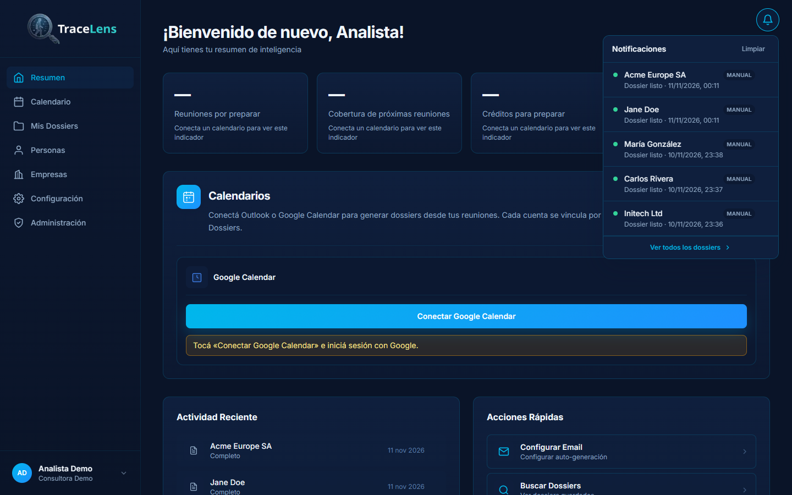

- La campana muestra cuántos avisos no has leído. Cada aviso dice si el dossier lo pediste tú
  (**Manual**) o lo generó la automatización.
- Llegan **en vivo**, sin recargar la página. Si se corta la conexión, la campana se reconecta
  sola.
- **Limpiar** borra la lista y **Ver todos los dossiers** abre Mis Dossiers.

## 10. Configuración

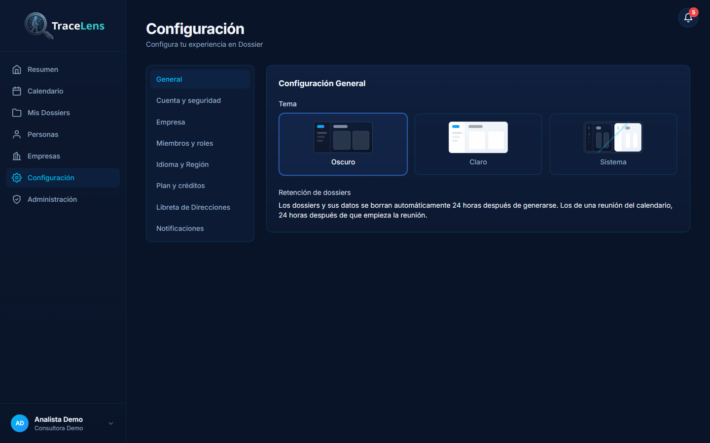

### 10.1 General

- **Tema:** Oscuro, Claro o Sistema (sigue al dispositivo).
- **Retención de dossiers:** los dossiers y sus datos se **borran automáticamente 24 horas después
  de generarse**. Los de una reunión del calendario, 24 horas después de que empieza la reunión.
  No se puede cambiar: es una medida de protección de datos.

### 10.2 Cuenta y seguridad

Nombre, correo y cambio de contraseña. Las sesiones se renuevan solas mientras uses la plataforma.

### 10.3 Empresa

Describe tu organización (sector, actividad). Los informes adaptan su enfoque a esa descripción.

### 10.4 Idioma y región

- **Idioma de la plataforma:** español, inglés (EE. UU. o Reino Unido), portugués, italiano,
  francés o alemán.
- **Idioma de salida del dossier:** el idioma en que se escriben los informes.
- **Zona horaria:** la del dispositivo o una elegida. Afecta las horas de reuniones y avisos.

### 10.5 Plan y créditos

Tu plan, el saldo y el tope mensual ([13](#13-planes-créditos-y-límites)).

### 10.6 Libreta de direcciones y notificaciones

- **Libreta de direcciones:** grupos de contactos frecuentes; se pueden importar desde Google
  Contacts.
- **Notificaciones:** preferencias de avisos.

## 11. Roles y permisos

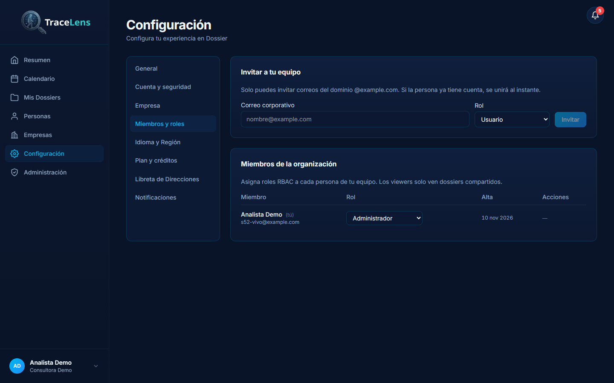

En **Configuración → Miembros y roles**, el administrador de la organización **invita** personas
(con correo del dominio de la empresa), les **asigna un rol** y puede **quitarlas**.

| Rol | Ver dossiers | Generar | Eliminar / compartir | Administrar el equipo |
|---|---|---|---|---|
| **Administrador** | Todos los de la organización | Sí | Sí | Sí |
| **Usuario** | Los suyos y los compartidos con él | Sí | Los suyos | No |
| **Viewer** | Solo los compartidos con él | No | No | No |

- Una persona puede estar en varias organizaciones, con un rol distinto en cada una.
- Si te quitan de una organización, pierdes el acceso a sus dossiers de inmediato, también a las
  notificaciones en vivo.

## 12. Administración de la plataforma

Esta sección es para el **equipo que opera TraceLens**, no para los clientes. Solo la ven los
usuarios con permiso de *administrador de plataforma*. Ese permiso lo otorga el equipo técnico
directamente en la base de datos.

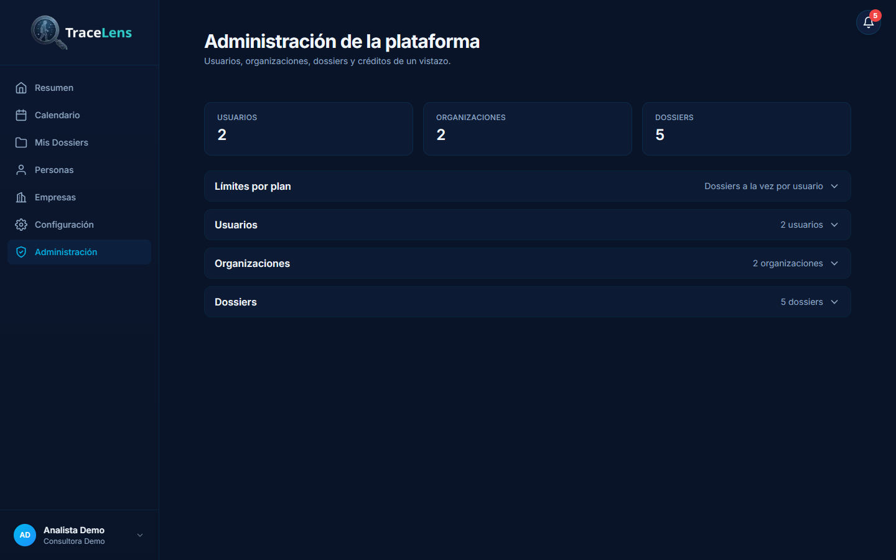

- **Resumen:** total de usuarios, organizaciones y dossiers.
- **Usuarios:** ver cuentas, dar o quitar el permiso de administrador de plataforma y eliminar
  cuentas. Nadie puede quitarse ese permiso a sí mismo.
- **Organizaciones** y **Dossiers:** listados de toda la plataforma.

### Límites por plan

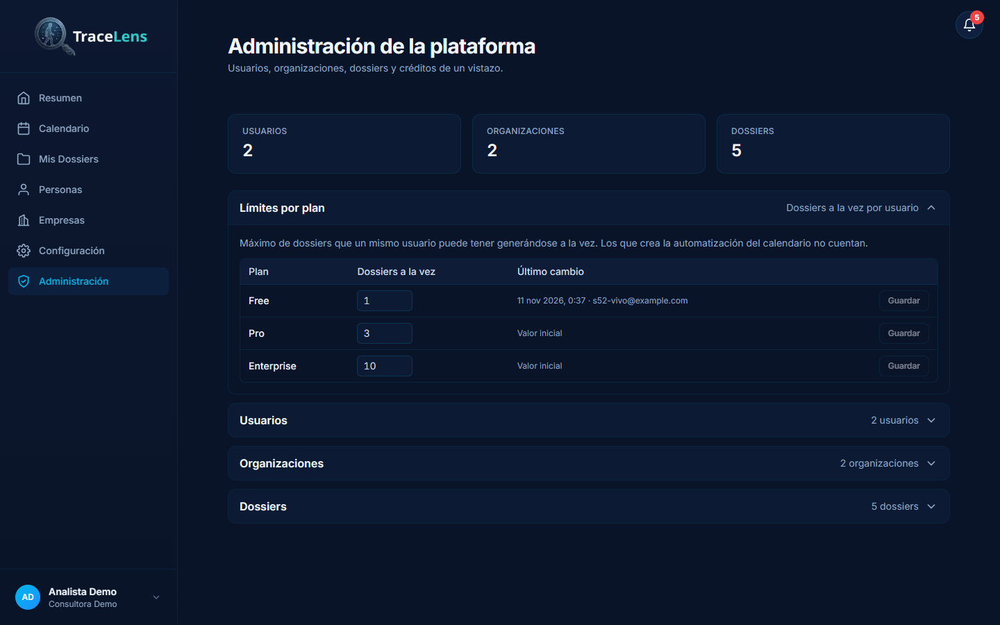

Define cuántos dossiers puede tener **generándose a la vez** un mismo usuario, según el plan de su
organización. Valores iniciales: **Free 1 · Pro 3 · Enterprise 10**.

1. Abre **Límites por plan**.
2. Cambia el número (entre 1 y 100) y pulsa **Guardar** en esa fila.
3. El cambio se aplica de inmediato y queda registrado en la auditoría, con quién lo hizo y cuándo.

Los dossiers que genera la **automatización del calendario no cuentan** para este límite.

## 13. Planes, créditos y límites

| | Free | Pro | Enterprise |
|---|---|---|---|
| Créditos al mes | 10 | 500 | Ilimitado |
| Dossiers de empresa | No | Sí | Sí |
| Automatización del calendario | No | Sí | Sí |
| Profundidad disponible | Básica | Básica, estándar y profunda | Básica, estándar y profunda |
| Dossiers a la vez por usuario* | 1 | 3 | 10 |

\* Valores iniciales; los ajusta el equipo de la plataforma ([12](#límites-por-plan)).

**Costo en créditos:** dossier de persona, 1 crédito. Dossier de una reunión según la profundidad:
básica 1, estándar 3, profunda 5 por dossier. El costo se muestra antes de generar.

## 14. Mensajes frecuentes y qué hacer

| Mensaje | Qué significa | Qué hacer |
|---|---|---|
| «Créditos insuficientes: se requieren N…» | Tu organización no tiene saldo para ese dossier | Espera la recarga mensual o cambia de plan |
| «Ya tienes N dossiers generándose, el máximo de tu plan…» | Llegaste al límite de dossiers a la vez | Espera a que termine uno |
| «Demasiados intentos. Espera N segundos…» | Muchos pedidos seguidos en poco tiempo | Espera los segundos que indica |
| «Se perdió la conexión con el servidor. La generación puede seguir en curso.» | Se cortó el aviso en vivo, no el dossier | Se reconecta sola; o pulsa **Reconectar** |
| «Tu sesión expiró o ya no es válida…» | La sesión venció | Vuelve a iniciar sesión |
| «Este dossier se acaba de enviar…» | Se reenvió el correo hace muy poco | Espera un momento |
| «Este enlace ya se usó o venció…» | El enlace del correo es de un solo uso y dura 24 h | Entra con tu cuenta |
| Dossier en estado **Parcial** («Informe parcial: no se pudo redactar el análisis con IA…») | La IA no respondió; se muestran los datos que sí trajeron los registros y la prensa. No se cobró | Vuelve a generarlo más tarde para tener el análisis completo |
| «No se pudieron consultar las fuentes de esta persona…» | El proveedor de datos de personas no respondió. No se cobró | Vuelve a intentarlo más tarde |
| «La generación se interrumpió porque el servidor se reinició…» | El servidor se reinició mientras se generaba; no se cobró | Vuelve a generarlo |
| Falta un dossier antiguo | Se borró a las 24 horas (retención) | Vuelve a generarlo |
